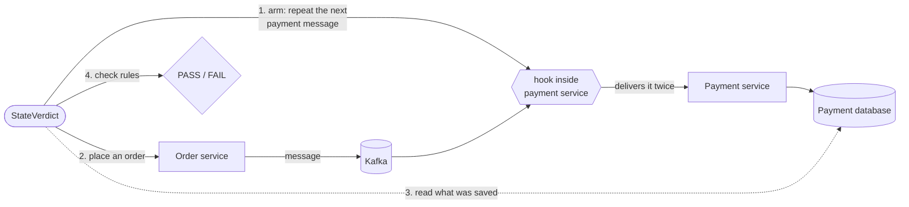

# StateVerdict

**Finds the bugs where every service says "OK" but the customer's money or order ends up wrong.**

[](https://github.com/sriharichepuri21/stateverdict/actions/workflows/ci.yml)
[](https://github.com/sriharichepuri21/stateverdict/actions/workflows/evaluation.yml)
[](LICENSE)

<picture>
  <source media="(prefers-color-scheme: dark)" srcset="docs/assets/hero-dark.svg">
  
</picture>

### ▶ [Try it in your browser](https://sriharichepuri21.github.io/stateverdict/): break a checkout and watch the verdict

## The problem, in one minute

An online shop is usually several small programs ("services") that send each other messages: the
order service tells the payment service *"please charge $129"*. Networks are imperfect, so sometimes a
message **arrives twice**, **arrives late**, or arrives **while the customer is cancelling**.

When that happens, every service can still answer `200 OK`, and normal tests pass, while the
customer has been **charged twice** or a **cancelled order ships anyway**.

StateVerdict tests for exactly this. It does three things:

| | Step | In plain words |
|---|---|---|
| 1 | **Cause the accident** | Repeat, delay or hold one exact message, on purpose, at the exact moment that matters |
| 2 | **Check the databases** | Ignore "OK" replies and logs. Read what was actually saved: orders, charges, refunds |
| 3 | **Give a verdict** | **PASS** or **FAIL** against business rules such as *"a customer is charged at most once"*, with the saved rows as evidence. If evidence is missing it says **INCONCLUSIVE**, never PASS |

## Does it work? Measured, not claimed

**On planted bugs.** Six realistic bugs and three harmless changes were planted in an example
shop. The shop's own tests and StateVerdict were run against each one, with predictions written
down first ([full results](docs/evaluation/results.md)):

<picture>
  <source media="(prefers-color-scheme: dark)" srcset="docs/assets/results-dark.svg">
  
</picture>

Both caught every bug. Three of the normal tests also failed on a *harmless* change, because they
check how the code works rather than what the customer gets. StateVerdict knew nothing about the code
and raised no false alarm.

**On someone else's app.** StateVerdict was pointed at
[a popular open-source Kafka shop](https://github.com/piomin/sample-spring-kafka-microservices) written
by another developer, without changing its business logic ([results](targets/piomin-saga/RESULTS.md)):

| What it found | How small the cause is |
|---|---|
| A rejected order makes **money appear out of nothing** (a `"PAYMENT"` vs `"payment"` mismatch) | One order the customer can't afford. No accident needed |
| A repeated message makes the customer **pay twice** | One repeated order request, whichever service receives it |
| A reply that is 12 seconds late leaves the order **stuck forever** | One delayed reply; 6 seconds is not enough to break it |

- **8 of 8** predictions written before the first run came true, each in 10 of 10 runs.
- **45 of 60** randomly generated scenarios broke the app.
- StateVerdict then **shrank** each failure to the single cause above, confirmed in 10 of 10 runs.
  One cause was not predicted at all: a repeat in the *stock* service makes the *customer* pay twice.

## Try it

**In the browser, no setup:** the [interactive explainer](https://sriharichepuri21.github.io/stateverdict/)
replays the measured results.

**On your machine, one command.** You only need Docker. A GitHub Codespace works out of the box.

```bash
scripts/demo.sh
```

It starts a database, Kafka and two services, then checks four things:

```text
1. baseline (naive handler)            expected PASS  got PASS         ok
2. duplicate (naive handler)           expected FAIL  got FAIL         ok
3. replay of step 2's evidence         expected FAIL  got FAIL         ok
4. duplicate (idempotent handler)      expected PASS  got PASS         ok

DEMO OK: the fault is detected against the naive handler and accepted after the fix.
```

<details>
<summary><b>What a verdict looks like</b> (real output from CI, ids shortened)</summary>

```text
Scenario:  checkout-duplicate-payment-request (v1)
Faults:    {type=DUPLICATE, topic=payment.requested, copies=2}
Execution: COMPLETED

Rule SV-002 v1
  At most one committed payment capture per order

  Expected: at most 1 capture
  Observed: 2 captures
  Result:   VIOLATED
  Why:      Order 949b5491-… was captured 2 times; captured event ids: aced970e-…, aced970e-….
  Evidence: payment.captures

Overall verdict: FAIL
Exit code:       1
```

Every reading of the database is kept in a JSON report with its source, time and a SHA-256 of the
exact response, so `stateverdict replay-evidence report.json` re-derives the same verdict later
without contacting any service.
</details>

## How it works



The hook is a few lines in each service, switched on only in test mode: messages pass through it,
and StateVerdict can tell it to hold, delay or repeat one exact message for one test run. Because it
acts on a specific message (not on the network), the same accident happens every time, and every
result is repeated 10 times to prove it is not luck.

<details>
<summary><b>For engineers: scenarios, random exploration and shrinking</b></summary>

### Scenarios: controlling the order of events

Some bugs need events to happen in a particular order. A **schedule** is a JSON list of steps:
arm a fault, place an order, wait until a message is held, cancel, release. For example, hold the
"payment completed" message, let the customer cancel, then release it. Against the buggy order
service the cancelled order ends **CONFIRMED** (FAIL in 10 of 10 runs); against the fixed one it stays
cancelled and is refunded (PASS in 10 of 10). See [scenarios/](scenarios/README.md).

```bash
SV="docker compose -f infrastructure/compose/docker-compose.yml --profile cli run --rm stateverdict"
$SV run-schedule scenarios/cancel-while-payment-completion-held.json --trials 10
```

### Exploration: scenarios nobody wrote

`explore` generates random but valid schedules from a seed: faults on any message, a customer who
cancels at different moments, and payments that are approved or declined. It saves every schedule
that breaks a rule as a file you can rerun. The same seed always gives the same schedules. In the
latest CI run, 35 of 60 broke the buggy version and all 60 passed against the fixed version
([details](docs/results/exploration.md)).

```bash
$SV explore --iterations 60 --seed 42
```

### Shrinking: the smallest scenario that still fails

`shrink` removes one fault or step at a time, keeps a removal only if the smaller scenario still
fails **every one** of 3 runs, and stops when nothing more can go. The result is confirmed over 10
runs. A failure that does not repeat reliably is measured and reported, not shrunk
([details](docs/results/shrinking.md)).

```bash
$SV shrink artifacts/found/<finding>.json
```

The explorer and shrinker know nothing about the system under test: each target supplies a
`ScheduleSpace` (how to generate, validate, simplify and describe its scenarios). The same engine runs
on the example shop and on the external app.
</details>

<details>
<summary><b>For engineers: design decisions</b></summary>

| Decision | Why | Record |
|---|---|---|
| Faults are injected by a hook *after* Kafka delivers the message | Exact control of one message; a network proxy cannot repeat one specific event | [ADR-002](docs/decisions/ADR-002-controlled-dispatch-after-consumption.md) |
| "Did the test run properly?" is kept separate from "is the rule true?" | A real violation is never hidden by a later infrastructure error; missing evidence is never a PASS | [ADR-004](docs/decisions/ADR-004-execution-and-rule-truth-are-separate.md) |
| The fix records each processed message in the same database transaction | Safe even when two copies arrive at the same moment, unlike "check, then insert" | [ADR-006](docs/decisions/ADR-006-idempotency-with-an-inbox-table.md) |
| The tool is one program; the system it tests is distributed | Keep the complexity where it is being tested | [ADR-001](docs/decisions/ADR-001-modular-monolith-core.md) |

Verdict precedence: any rule **VIOLATED** → FAIL (exit 1); otherwise an infrastructure failure → ERROR
(exit 3); otherwise a timeout or missing evidence → INCONCLUSIVE (exit 2); otherwise PASS (exit 0).
</details>

<details>
<summary><b>For engineers: repository layout and CLI</b></summary>

| Path | What it is |
|---|---|
| `apps/stateverdict-core/` | Runner, evidence, rules, verdicts, explorer, shrinker, replay, CLI (plain Java 21) |
| `libs/stateverdict-dispatch/` | The test-mode hook: hold, delay, repeat, repeat concurrently, journal |
| `examples/commerce/` | Example shop: order and payment services (Spring Boot 4.1, Kafka 4.1, PostgreSQL 17) |
| `targets/piomin-saga/` | The external app: pinned commit, small adapter patch (GPL-3.0), scenarios, results |
| `docs/` | Decision records, measured results, the interactive explainer (`docs/site`) |

```bash
SV="docker compose -f infrastructure/compose/docker-compose.yml --profile cli run --rm stateverdict"
$SV run checkout-duplicate-payment-request --copies 2 --trials 10
$SV replay-evidence artifacts/dup.json        # same verdict, no services contacted
```

Developing with Java 21 and Maven: `mvn -B verify` runs all 184 tests, using Testcontainers for
PostgreSQL and Kafka. CI also runs the demo, every measurement above, the planted-bug evaluation and
the external app on every pull request.
</details>

<details>
<summary><b>Limits, stated plainly</b></summary>

- Two applications so far: the example shop and one external app, each at a pinned version.
- Faults are applied where a service receives a message. Broker failures and partition rebalances
  are out of scope.
- Every result is repeated 10 times on one kind of CI machine. That is enough to catch a flaky
  result, not to make claims about very rare failures.
- The planted bugs and the example shop's tests were written by the same person. The external app is
  the answer to that, and it is reported with what StateVerdict did and did not contribute.
</details>

## Guiding principle

Never report a verified business outcome without sufficient, trustworthy evidence.
Missing evidence produces **INCONCLUSIVE**, never **PASS**.

StateVerdict is licensed under [Apache-2.0](LICENSE).
